# Gate-E payment integration

Small PHP + MySQL checkout for the Bab Al Bahrain assessment. You fill in your details, pay through Gate-E inside an iframe, and the result is saved in the database.

## Setup

1. Create the database and tables:

       mysql -u root -p -e "CREATE DATABASE bab_al_bahrain"
       mysql -u root -p bab_al_bahrain < sql/schema.sql

   Note: schema.sql drops and recreates the tables.

2. Copy `config/config.example.php` to `config/config.php` and fill in the DB details, the Gate-E user/key and the gateway id.

3. Start the server and open http://localhost:8000/

       php -S localhost:8000

## How it works

- `index.php` - checkout form. `assets/app.js` posts it with AJAX to `api/create_payment.php`.
- `api/create_payment.php` - saves the customer, inserts a `pending` payment, creates the payment on Gate-E and returns the payment link, which is shown in the iframe.
- `callback.php` - Gate-E redirects here after payment. It asks Gate-E for the payment, saves the transactions, updates the status and shows the result.
- `webhook.php` - same update, but called by Gate-E's server (only works if the site is reachable from the internet).
- `payments.php` - list of all payments. "View" opens a modal that calls `api/payment_details.php`, which returns the DB data plus the live data from Gate-E.
- `includes/` - DB connection and the helper functions.

Tables: `customers`, `payments`, `transactions`.

## Testing

Card 1111 2222 3333 4444, expiry 12/30.

- CVV 123: success
- CVV 999: failed
- any other CVV: card form stays open, nothing recorded

## Screenshots

Checkout page with Gate-E in the iframe:

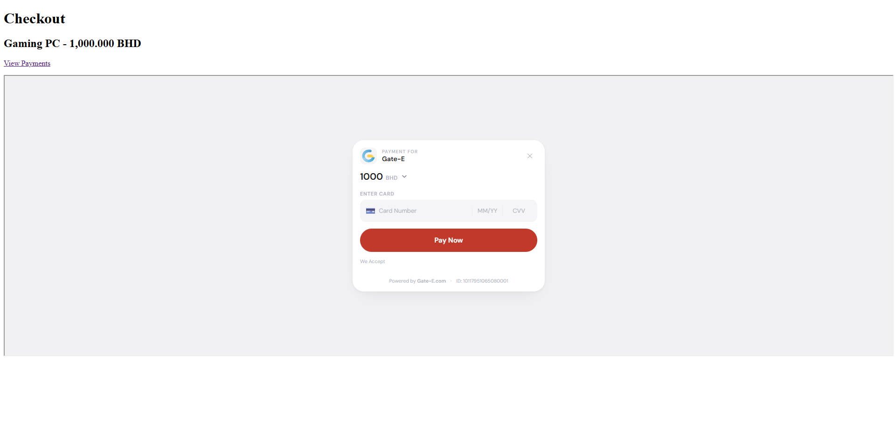

Form validation:

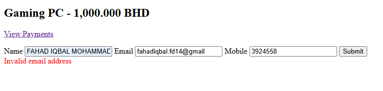
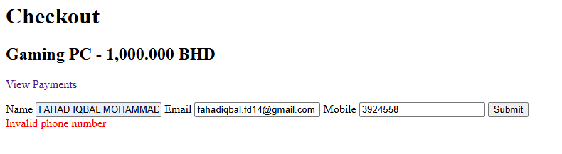

Successful payment (CVV 123) and the callback page:

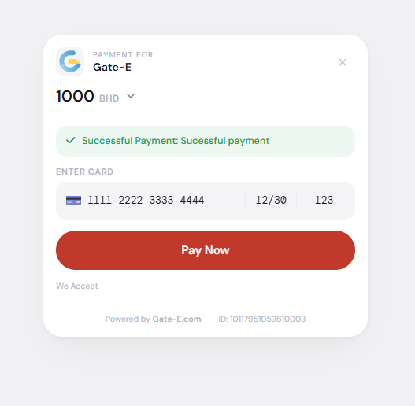
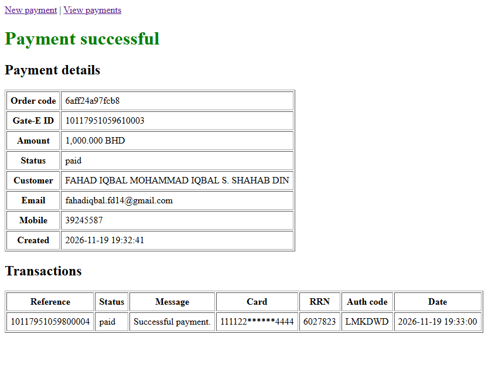

Failed payment (CVV 999) and the callback page:

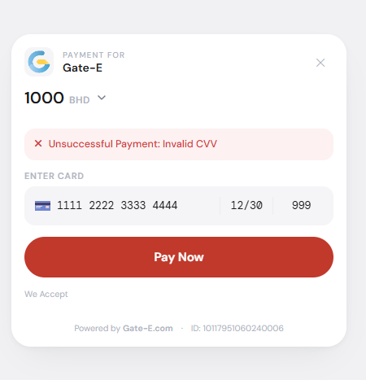
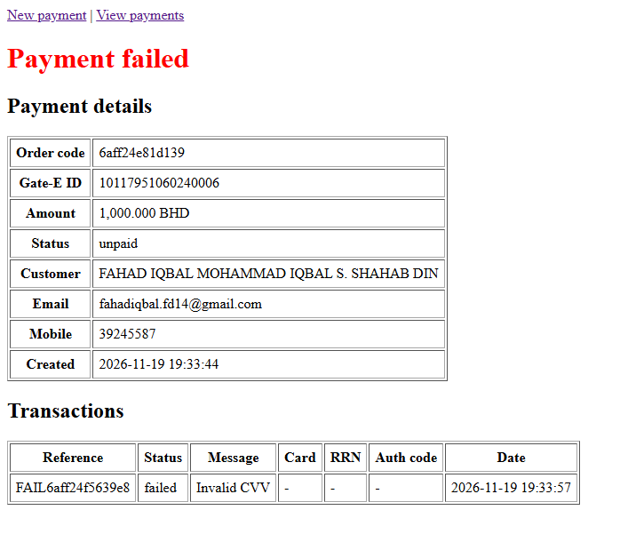

Other CVV, user can try again:

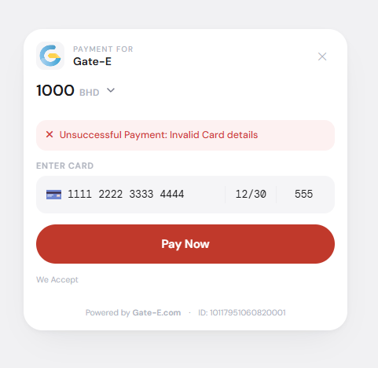

Payments list:

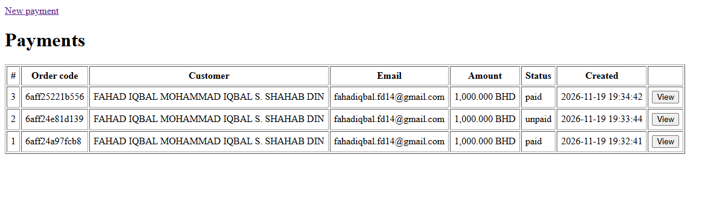

View modal - pending, paid and failed:

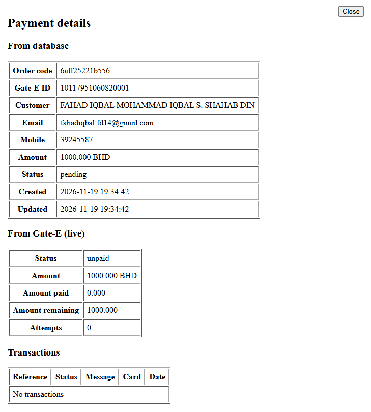
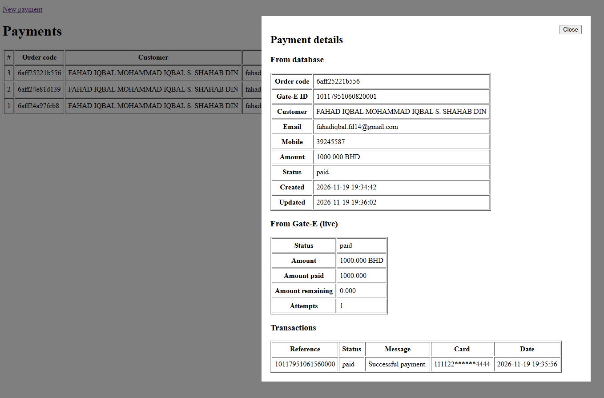
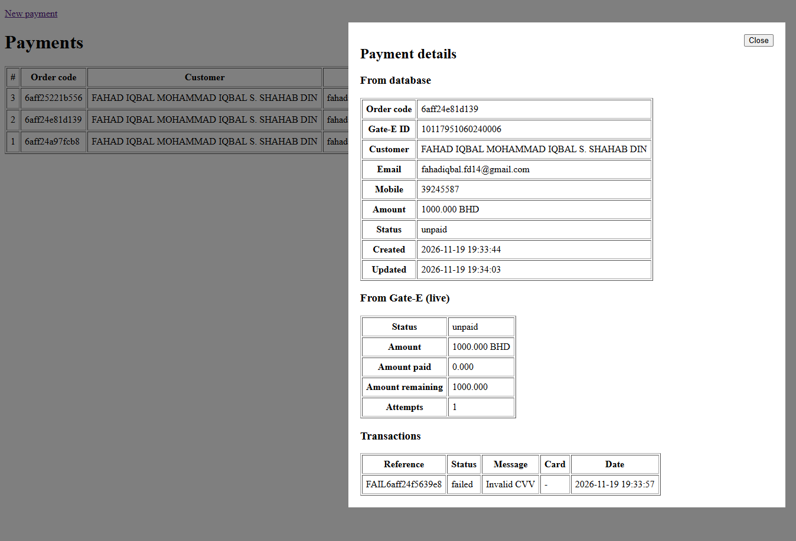

Database tables:

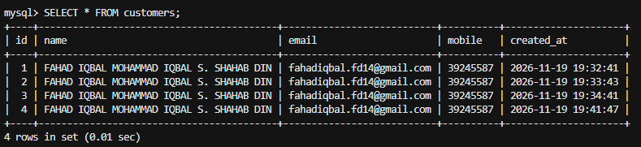
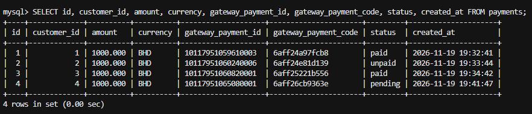
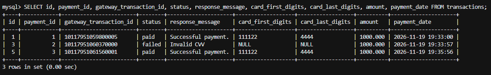
